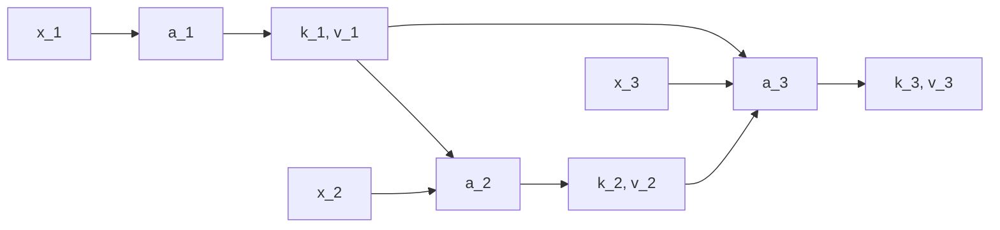
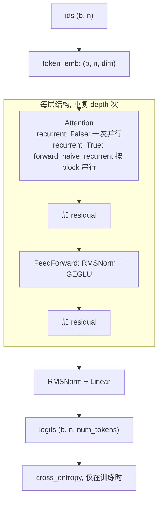

# Recurrent Transformer 架构总览

本仓库是论文 The Recurrent Transformer: Greater Effective Depth and Efficient Decoding (Oncescu et al., [arXiv 2604.21215](https://arxiv.org/abs/2604.21215)) 的 PyTorch 探索性实现, README 将其标为 wip. 这份文档回答两个问题: 这个架构相对标准 Transformer 改了什么, 以及本仓库的实现在哪些地方与论文不同. 组件的接口和参数细节见 [core_components.md](./core_components.md), 前向与解码的数据流见 [model_inference_flow.md](./model_inference_flow.md).

## 仓库文件与职责

| 文件 | 职责 |
|---|---|
| `recurrent_transformer/recurrent_transformer.py` | 全部模型组件: `LoRA`, `RelativePositionBias`, `Attention`, `GEGLU`, `FeedForward`, `RecurrentTransformer` |
| `recurrent_transformer/__init__.py` | 对外导出 `Attention` 和 `RecurrentTransformer` |
| `train_parity_extrapolation.py` | parity 任务的训练和长度外推评估脚本 |
| `tests/test_recurrent_transformer.py` | 18 组参数组合的冒烟测试 |
| `fig3.png` | 论文 Fig.3, 展示论文的精确 tiling 算法 |
| `pyproject.toml` | 包名 `recurrent-transformer-pytorch`, 依赖 `torch`, `einops`, `einx`, `x-mlps-pytorch` |

## 标准 Transformer 的时间深度上限

论文摘要把标准 Transformer 称为 temporally shallow. 原因在于 KV 的来源. 记 $x_s^{(l)}$ 为第 $l$ 层在位置 $s$ 的输入, 也就是 residual stream 在该处的向量. 标准 Transformer 第 $l$ 层的 KV 只由本层输入投影得到:

$$
k_s^{(l)} = W_K\,\mathrm{norm}\big(x_s^{(l)}\big), \qquad v_s^{(l)} = W_V\,\mathrm{norm}\big(x_s^{(l)}\big), \qquad s \le t
$$

位置 $t$ 在第 $l$ 层 attend 到集合 $\{(k_s^{(l)}, v_s^{(l)})\}_{s \le t}$. 这些 KV 在第 $l-1$ 层算完后就全部确定, 与第 $l$ 层内部的计算无关. 从任一输入 Token 到 $x_t^{(L)}$ 的串行计算路径, 每层最多经过一次. 路径长度因此与层数 $L$ 成正比, 不随位置 $t$ 增长. 摘要的原话是 "yielding a depth capped by the number of layers".

parity 任务可以说明这个上限的影响. 位置 $t$ 的目标是前 $t$ 个比特的奇偶性, 可以写成逐位更新的状态 $p_t = p_{t-1} \oplus x_t$, 其中 $\oplus$ 是异或. 这条更新链的长度随 $t$ 增长. 仓库的 `train_parity_extrapolation.py` 用这个任务检验模型能否把短序列上学到的计算外推到长序列.

## 核心改动: KV 来自本层激活

论文摘要的描述是 "each layer attends to key-value pairs computed off its own activations". 下面按本仓库 `block_size = 1` 时的实现, 写出单层在位置 $t$ 的计算. 为了突出递归结构, 公式省略层号上标, 多头切分和相对位置 bias. 各步与代码的对应见 [core_components.md](./core_components.md) 中的 Attention 一节.

第一步用本层输入计算 query 和临时 KV. 记 $u_t = \mathrm{norm}(x_t)$, 则

$$
q_t = \mathrm{qnorm}(W_Q u_t), \qquad \tilde k_t = \mathrm{knorm}(W_K u_t), \qquad \tilde v_t = W_V u_t + \mathrm{MLP}_v(W_V u_t)
$$

$\tilde k_t, \tilde v_t$ 对应论文 Fig.3 中的 $kv_t^{\text{temp}}$, 只在位置 $t$ 自己的 attention 中使用.

第二步计算 attention 输出. 位置 $t$ 的 query attend 到之前各位置的持久 KV 和自己的临时 KV:

$$
a_t = W_O\Big[\, g_t \odot \mathrm{Attn}\big(q_t;\ [k_1, \dots, k_{t-1}, \tilde k_t];\ [v_1, \dots, v_{t-1}, \tilde v_t]\big) \Big], \qquad g_t = \sigma\big(\mathrm{LoRA}(u_t)\big)
$$

其中 $g_t$ 是逐通道的 attention gate, $\sigma$ 是 sigmoid, $\odot$ 是逐元素乘法.

第三步用 attention 子层的输出生成位置 $t$ 的持久 KV:

$$
h_t = \mathrm{norm}(x_t + a_t), \qquad k_t = \mathrm{knorm}(W_K h_t), \qquad v_t = W_V h_t + \mathrm{MLP}_v(W_V h_t)
$$

第一步和第三步共用同一组 $W_K$, $W_V$, $\mathrm{knorm}$, $\mathrm{MLP}_v$ 和 $\mathrm{norm}$ 的参数, 只是输入不同. 持久 KV 进入 memory, 供之后的位置使用.

第四步与标准 Transformer 相同. residual 相加后接 FeedForward: $x'_t = x_t + a_t$, 下一层输入为 $x'_t + \mathrm{FFN}(x'_t)$.

这四步产生了一条层内的依赖链. $k_t, v_t$ 依赖 $a_t$, 而 $a_t$ 依赖 $k_{t-1}, v_{t-1}$, 后者又依赖 $a_{t-1}$. README 展示的 Fig.3 图注写道: $(k_t, v_t)$ 要等 $a_t$ 算完才可用, 而 $a_t$ 要等位置 $t$ attend 完之前所有 KV 才能算出. 于是单层内部出现一条长度为 $t$ 的串行路径, 串行深度随位置增长. 这就是论文标题中 greater effective depth 的来源.

与 RNN 相比, 位置 $t$ 仍然直接 attend 到所有更早位置的持久 KV, 历史没有被压缩成固定大小的状态. 每个位置在每层只存一对持久 KV, 大小与标准 KV cache 相同. 摘要据此称该架构 "preserving standard autoregressive decoding cost".

## 模型整体结构

`RecurrentTransformer` 是 decoder-only 语言模型. `recurrent` 参数只决定每层 attention 的执行方式, 其余结构两种模式相同.

两种模式下层与层之间都是逐层计算: 第 $l$ 层处理完整条序列后, 第 $l+1$ 层才开始. 递归只发生在每层 attention 的内部, 方向沿时间维度. FeedForward 始终对所有位置并行计算.

## 本实现的组件选择

下表列出实现中偏离最朴素 Transformer 的组件. 来源一列只记录代码注释, README 引用和 commit 说明中已有的信息.

| 组件 | 做法 | 仓库中记录的来源 |
|---|---|---|
| value MLP | 每个 head 的 value 经残差 MLP ($d \to 2d \to d$, ReLU), 在加权求和之前加入非线性 | 代码注释引用 ICLR 2026 的图像复原论文 (README 中的 Ren et al.) |
| attention gate | $\sigma(\mathrm{LoRA}(u_t))$ 逐通道乘到合并 head 后的 attention 输出上 | 代码注释引用 AlphaFold2 (Jumper et al.) |
| qk norm | 每个 head 的 q 和 k 分别做 RMSNorm | 无 |
| 相对位置 bias | 默认只用 learned ALiBi, 可选叠加距离基曲线 | ALiBi (Press et al.); 距离基曲线据代码注释借鉴 Thinking Machines 的 Inkling 模型 |
| 位置编码 | 不使用绝对位置编码或 RoPE, 位置信息只来自相对位置 bias 和 causal mask | commit a0b2d11 的说明: 只有加入 learned ALiBi 后, 模型才解出 parity |
| FeedForward | pre-norm GEGLU, 隐藏维度为 $\lfloor \text{dim} \cdot \text{expansion} \cdot 2/3 \rfloor$ | 无 |
| 初始化 | 每层两个子层输出投影的标准差为 $1/\sqrt{2 \cdot \text{fan\_in} \cdot l}$, $l$ 是从 1 开始的层号 | 代码注释: Yang et al., 沿用 Wortsman 的初始化方案 |

## 与论文的差异

论文一列只使用摘要和 Fig.3 图注中的信息. 论文正文的具体公式没有记录在本仓库中.

| 方面 | 论文 | 本仓库 |
|---|---|---|
| 持久 KV 的来源 | 由本层自身激活计算 | 由 $\mathrm{norm}(a_t + x_t)$ 重新投影, 不经过 FeedForward. commit eddf128 说明这是有意偏离论文, 非线性改由 value MLP 和 attention gate 提供 |
| 训练和 prefill 算法 | 精确的 tiling 算法, 计算结果不变. 摘要称 HBM 访存量从 $\Theta(N^2)$ 降到 $\Theta(N \log N)$ | `forward_naive_recurrent` 按 block 串行循环. `block_size = 1` 时的可见结构对应逐 Token 递归. `block_size > 1` 时 block 内改用临时 KV 交互, 计算结果随 `block_size` 改变 |
| 解码 | 摘要称保持标准自回归解码代价 | 模型层面没有增量解码接口. `Attention` 的 `memory` 参数足以实现, 做法见 [model_inference_flow.md](./model_inference_flow.md) |

第二行的结论经过本地验证. 在同一组随机权重下, `block_size = 1` 和 `block_size = 2` 的输出最大差约为 0.02, 只有第一个位置完全相同. 仓库中的 `fig3.png` 是论文的精确算法示意图. `block_size` 参数实现的是另一种近似, 不是这张图的实现.
