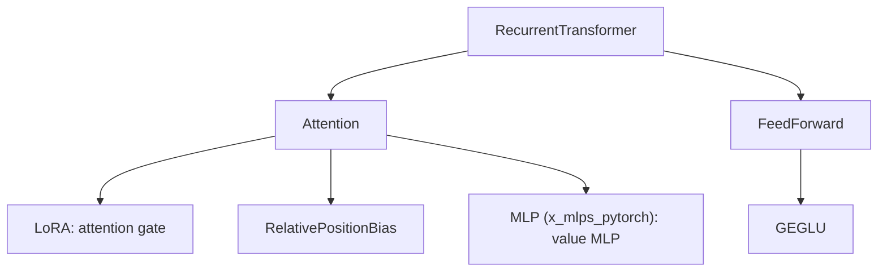

# 核心组件说明

所有组件都定义在 `recurrent_transformer/recurrent_transformer.py` 中. 这份文档按依赖顺序说明每个组件的参数, 张量形状, 计算公式和使用约束. 递归机制的动机见 [architecture_overview.md](./architecture_overview.md), 前向和解码过程见 [model_inference_flow.md](./model_inference_flow.md).

## 张量维度记号

| 记号 | 含义 |
|---|---|
| `b` | batch size |
| `n` | 本次调用处理的序列长度, 递归模式下是一个 block 的长度 |
| `m` | memory 中已有的 KV 个数, 即当前 tokens 之前的位置数 |
| `h`, `d` | attention head 数 `heads`, 每个 head 的维度 `dim_head` |
| `i`, `j` | attention 矩阵的 query 数和 key 数; 带 memory 时 $j = m + i$ |
| `V` | 词表大小 `num_tokens` |

## 组件依赖关系

包的 `__init__.py` 只导出 `Attention` 和 `RecurrentTransformer`. 其他组件需要从 `recurrent_transformer.recurrent_transformer` 导入.

## 辅助函数

`exists(v)` 判断 `v is not None`. `default(v, d)` 在 `v` 为 `None` 时返回 `d`. `inv_sqrt(n)` 返回 $n^{-1/2}$, 用于 attention 缩放和初始化标准差. `LinearNoBias` 是 `partial(Linear, bias = False)`, 用于 QKV 投影, attention 输出投影, LoRA 和输出层.

## LoRA: attention gate 的低秩投影

`LoRA(dim, dim_out, low_rank = 32)` 是两个不带 bias 的 Linear 串联, 映射为 $\mathbb{R}^{\text{dim}} \to \mathbb{R}^{r} \to \mathbb{R}^{\text{dim\_out}}$, 其中 $r$ 是 `low_rank`. 参数量为 $(\text{dim} + \text{dim\_out}) \cdot r$.

构造时断言 $r < \text{dim}$ 且 $r < \text{dim\_out}$. `Attention` 中 $\text{dim\_out} = h \cdot d$, 所以 `gate_low_rank` 要同时小于 `dim` 和 `dim_head * heads`. parity 脚本中 `dim = 32`, `dim_head * heads = 32`, 默认的 `gate_low_rank = 32` 会触发断言. 脚本因此把它设为 16.

两个子层的命名与方向相反: `self.up` 把 `dim` 压缩到 $r$, `self.down` 再把 $r$ 映射到 `dim_out`.

## RelativePositionBias: 相对位置 bias

`RelativePositionBias(heads, num_distance_basis = 16, max_dist = 1024, learned_alibi = True, distance_basis = False)` 返回形状为 `(h, i, j)` 的 bias, 直接加到 attention logits 上. 模型没有其他位置编码. 因此长度外推能力取决于这个模块.

### 位置对齐与相对距离

调用 `forward(seq_len_q, seq_len_k)` 时, query 对齐到 key 序列的末尾. 第 $r$ 个 query ($0 \le r < i$) 的绝对位置为 $r + (j - i)$, 第 $c$ 个 key 的绝对位置为 $c$. 相对距离定义为

$$
\delta_{r,c} = r + (j - i) - c
$$

$\delta > 0$ 表示 key 在 query 之前. $\delta < 0$ 是未来位置, 之后会被 causal mask 屏蔽. 带 memory 调用时 $j - i = m$, 当前 block 的 query 因此得到正确的绝对位置.

### 两个 bias 分量

learned ALiBi 分量给每个 head $h$ 一个可学习斜率 $s_h$:

$$
B^{\text{alibi}}_h(\delta) = -s_h \cdot \delta
$$

$s_h$ 全部初始化为 1. 原版 ALiBi 使用固定的几何级数斜率, 这里的斜率参与训练, 也没有符号约束.

距离基分量维护 $K$ 条共享曲线 $C_1, \dots, C_K$, 每条曲线在 $0 \le \delta < D$ 上各有一个可学习值, 其中 $K$ 是 `num_distance_basis`, $D$ 是 `max_dist`. 每个 head 用自己的权重 $w_{h,k}$ 组合这些曲线:

$$
B^{\text{basis}}_h(\delta) = \sum_{k=1}^{K} w_{h,k}\, C_k(\delta)
$$

曲线值初始化为 $\mathcal{N}(0, 0.02^2)$, 权重 $w$ 初始化为 0, 所以训练开始时这个分量恒为 0. 两个分量都启用时, 返回值是两者之和.

### 超出 max_dist 时的 bias

函数最后把无效位置的 bias 置为 0. 只启用 learned ALiBi 时, 无效位置只有未来位置. 启用 `distance_basis` 后, $\delta \ge D$ 的位置也标为无效, 其 ALiBi 惩罚随之清零.

本地用 `heads = 1`, `max_dist = 4`, 同时启用两个分量做了检查. 位置 7 的 query 对 key 0 到 7 的 bias 为 `[0, 0, 0, 0, -3, -2, -1, 0]`. 距离 4 到 7 的 key 得到 0, 距离 1 到 3 的 key 得到负值. 远处 key 的 bias 因而高于近处 key, 与 ALiBi 的线性衰减方向相反. 这种情况只在启用 `distance_basis` 且序列长度超过 `max_dist` (默认 1024) 时出现. 默认配置不受影响.

## Attention: 支持三种 memory 模式的因果 attention

`Attention` 是 pre-norm 多头因果 attention. 它只返回 attention 分支的增量 `attn_out`, residual 相加在 `RecurrentTransformer.forward` 中完成.

### 子模块

| 属性 | 类型与形状 | 作用 |
|---|---|---|
| `norm` | `RMSNorm(dim)` | pre-norm; 递归模式生成持久 KV 前复用 |
| `to_queries` | `dim -> h*d`, 无 bias | query 投影 |
| `to_keys_values` | `dim -> 2*h*d`, 无 bias | K 和 V 共用一次投影, 沿最后一维对半切分 |
| `q_norm`, `k_norm` | `RMSNorm(d)` | 对每个 head 的 q 和 k 做 RMSNorm |
| `value_mlp` | `MLP(d, 2d, d)` | value 的残差 MLP. 本地打印的结构为 `Linear(d, 2d) + ReLU + Linear(2d, d)`, 两层带 bias |
| `attn_gate` | `LoRA(dim, h*d, gate_low_rank)` | 生成 gate logits, sigmoid 后与 attention 输出逐元素相乘 |
| `to_out` | `h*d -> dim`, 无 bias | 输出投影, 按层深缩放初始化 |
| `rel_pos_bias` | `RelativePositionBias` | 相对位置 bias |
| `block_size` | int | 只在 `forward_naive_recurrent` 中使用 |

`use_value_mlp`, `attn_gate`, `rel_pos_bias` 为 `False` 时, 对应属性为 `None`, 前向时跳过.

### 单次 forward 的计算

`forward(tokens, memory = None, return_memory = False, return_recurr_memory = False)` 中, `tokens` 的形状为 `(b, n, dim)`, 可选的 `memory` 是一对形状为 `(b, h, m, d)` 的张量. 计算按以下顺序进行:

1. 保存 `residual = tokens`, 再计算 `tokens = norm(tokens)`.
2. 投影出 q, k, v, 切分为 `(b, h, n, d)`. q 和 k 各做 RMSNorm, v 加上 `value_mlp(v)`.
3. 若有 memory, 把 memory 的 K 和 V 拼在当前 k, v 之前, key 数变为 $m + n$.
4. 计算打分矩阵 `sim`, 形状为 `(b, h, i, j)`, 其中 $i = n$, $j = m + n$.
5. 施加 causal mask, 做 softmax, 对 v 加权求和, 合并 head 得到 `(b, n, h*d)`.
6. 乘以 `sigmoid(attn_gate(tokens))`, 经 `to_out` 得到 `attn_out`, 形状为 `(b, n, dim)`.

第 4 步中, 第 $r$ 个 query 与第 $c$ 个 key 的打分为

$$
S_{r,c} = \frac{q_r \cdot k_c}{\sqrt{d}} + B_h(\delta_{r,c})
$$

$B_h$ 是上一节的相对位置 bias. 第 5 步的 causal mask 由 `ones(i, j).triu(j - i + 1)` 生成, 屏蔽 $c > r + (j - i)$ 的位置, 也就是 $\delta_{r,c} < 0$ 的未来位置. 被屏蔽位置填入 `-finfo(dtype).max`, 不是 `-inf`. memory 中的 KV 对所有 query 可见, 当前 tokens 之间是下三角可见.

第 6 步 gate 的输入是第 1 步 norm 后的本层输入, 不是 attention 的输出.

### 三种返回模式

| 调用方式 | 返回值 | 返回的 memory 内容 | 用途 |
|---|---|---|---|
| 两个开关都为 `False` | `attn_out` | 无 | 并行训练和推理 |
| `return_memory = True` | `attn_out, (k, v)` | 拼接后的输入 KV, 形状 `(b, h, m+n, d)` | 标准 KV cache |
| `return_recurr_memory = True` | `attn_out, (next_k, next_v)` | 拼接后的持久 KV, 形状 `(b, h, m+n, d)` | 递归模式 |

两个开关同时为 `True` 会触发断言.

### 持久 KV 的构造

`return_recurr_memory = True` 时, 函数在得到 `attn_out` 之后额外计算:

1. `next_token = norm(attn_out + residual)`. 这是 attention 子层的输出再经 norm, 不经过 FeedForward.
2. 用 `to_keys_values` 投影出 `next_k` 和 `next_v`, 切分 head. `next_k` 做 `k_norm`, `next_v` 加上 `value_mlp(next_v)`.
3. 把新 KV 拼在旧 memory 之后返回.

这一步与第 2 步共用 `norm`, `to_keys_values`, `k_norm` 和 `value_mlp` 的参数. query 不重新计算. 当前 tokens 的输入 KV 在 attention 中用完后丢弃, 不进入 memory. 与标准 attention 相比, 每个 Token 多一次 KV 投影和一次 value MLP.

### forward_naive_recurrent: 按 block 串行递归

`forward_naive_recurrent(tokens, return_memory = False)` 把 `tokens` 沿序列维度按 `block_size` 切块. 最后一块可以不足 `block_size` 个 Token. 函数对每块依次调用 `self(block, memory = memory, return_recurr_memory = True)`, 并把返回的持久 KV 作为下一块的 memory. 各块输出拼接后返回 `(b, n, dim)`. `return_memory = True` 时还返回全部位置的持久 KV.

每个 block 中的 query 能看到两类 KV: 之前所有 block 的持久 KV, 以及本 block 内当前及更早位置的输入 KV. 同一 block 内的位置之间不交换持久 KV. 层内串行依赖链的长度因此是 $\lceil t / B \rceil$, 不是 $t$, 其中 $B$ 为 `block_size`. `block_size` 在串行步数和有效深度之间取舍. 具体的可见性表见 [model_inference_flow.md](./model_inference_flow.md).

memory 没有 `detach`. 训练时梯度沿整条 memory 链反向传播, 行为类似 RNN 的 BPTT.

## GEGLU 与 FeedForward

`FeedForward(dim, expansion = 4.)` 返回一个 `Sequential`: `RMSNorm(dim)`, `Linear(dim, 2 * dim_inner)`, `GEGLU()`, `Linear(dim_inner, dim)`. 两个 Linear 都带 bias. `GEGLU` 把最后一维对半切成值 $z_a$ 和门 $z_g$, 输出 $z_a \odot \mathrm{GELU}(z_g)$. 记 $u = \mathrm{RMSNorm}(x)$, 整个模块计算

$$
\mathrm{FFN}(x) = W_2\big[(W_a u) \odot \mathrm{GELU}(W_g u)\big]
$$

其中 $W_a$ 和 $W_g$ 是第一个 Linear 输出的前一半和后一半.

隐藏维度取 $\text{dim\_inner} = \lfloor \text{dim} \cdot e \cdot 2/3 \rfloor$, $e$ 为 `expansion`. 这个系数让权重参数量与隐藏维度为 $e \cdot \text{dim}$ 的普通两层 MLP 相同 (不计 bias, 忽略取整). 推导如下. 普通 MLP 有两个矩阵, 参数量为

$$
\text{dim} \cdot (e \cdot \text{dim}) + (e \cdot \text{dim}) \cdot \text{dim} = 2e \cdot \text{dim}^2
$$

GEGLU 的第一个矩阵输出 $2 \cdot \text{dim\_inner}$ 维, 第二个矩阵输入 $\text{dim\_inner}$ 维, 参数量为

$$
\text{dim} \cdot 2\,\text{dim\_inner} + \text{dim\_inner} \cdot \text{dim} = 3\,\text{dim} \cdot \text{dim\_inner} = 3\,\text{dim} \cdot \tfrac{2}{3} e\,\text{dim} = 2e \cdot \text{dim}^2
$$

## RecurrentTransformer: 完整模型

### 构造参数

| 参数 | 默认值 | 作用 |
|---|---|---|
| `num_tokens` | 必填 | 词表大小 $V$ |
| `dim` | 必填 | residual stream 维度 |
| `depth` | 必填 | 层数 |
| `dim_head`, `heads` | 64, 8 | 每个 head 的维度和 head 数 |
| `ff_expansion` | 4.0 | FeedForward 的扩展倍数 |
| `recurrent` | `False` | 是否启用层内递归 |
| `block_size` | 1 | 递归模式下每个 block 的 Token 数, 并行模式下不生效 |
| `attn_gate`, `gate_low_rank` | `True`, 32 | attention gate 开关和 LoRA 秩 |
| `use_value_mlp` | `True` | value MLP 开关 |
| `rel_pos_bias`, `rel_pos_bias_kwargs` | `True`, `{}` | 相对位置 bias 的开关和构造参数 |

所有参数都是 keyword-only. `value_mlp_expansion` 没有从 `RecurrentTransformer` 透传, 固定为 `Attention` 的默认值 2.0.

### 模块组成和初始化

模型包含 `token_emb` (`nn.Embedding(V, dim)`), 由 `depth` 个 `ModuleList([attn, ff])` 组成的 `layers`, 以及 `to_logits` (`RMSNorm(dim)` 加无 bias 的 `Linear(dim, V)`). embedding 与输出层不共享权重.

构造每层时, 代码重新初始化两个子层输出投影的权重, 即 `attn.to_out` 和 `ff[-1]`:

$$
W \sim \mathcal{N}\!\left(0,\ \sigma_l^2\right), \qquad \sigma_l = \frac{1}{\sqrt{2 \cdot \text{fan\_in} \cdot l}}
$$

$l$ 是从 1 开始的层号. `attn.to_out` 的 $\text{fan\_in} = h \cdot d$, `ff[-1]` 的 $\text{fan\_in} = \text{dim\_inner}$. 层越深, 初始时写入 residual stream 的增量越小. 其他参数使用 PyTorch 默认初始化. 代码注释把这一方案归于 Yang et al., 并称其沿用 Wortsman 的初始化方案.

### 前向

每层依次执行 `tokens = forward_attn(tokens) + tokens` 和 `tokens = ff(tokens) + tokens`. `recurrent = True` 时 `forward_attn` 是 `attn.forward_naive_recurrent`, 否则是 `attn` 本身. `forward` 支持三种目标设置: 返回 logits, 自回归语言模型 loss, 以及逐位置对齐的 labels loss. 它们的区别见 [model_inference_flow.md](./model_inference_flow.md) 的调用入口一节.

### 参数量示例

以 parity 脚本的配置 (`num_tokens = 2`, `dim = 32`, `depth = 2`, `dim_head = 16`, `heads = 2`, `gate_low_rank = 16`) 为例, 本地统计的总参数量为 29,464. 单层明细如下:

| 子模块 | 计算 | 参数量 |
|---|---|---|
| `norm` | $32$ | 32 |
| `to_queries` | $32 \times 32$ | 1,024 |
| `to_keys_values` | $32 \times 64$ | 2,048 |
| `q_norm`, `k_norm` | $16 + 16$ | 32 |
| `value_mlp` | $16 \times 32 + 32 + 32 \times 16 + 16$ | 1,072 |
| `attn_gate` | $32 \times 16 + 16 \times 32$ | 1,024 |
| `to_out` | $32 \times 32$ | 1,024 |
| `rel_pos_bias` | 2 个 ALiBi 斜率 | 2 |
| Attention 小计 | | 6,258 |
| FeedForward | $32 + (32 \times 170 + 170) + (85 \times 32 + 32)$, 其中 $\text{dim\_inner} = \lfloor 32 \cdot 4 \cdot 2/3 \rfloor = 85$ | 8,394 |

两层合计 $2 \times (6258 + 8394) = 29{,}304$. 加上 `token_emb` 的 $2 \times 32 = 64$ 和 `to_logits` 的 $32 + 32 \times 2 = 96$, 总数为 29,464.

## 测试与实验脚本

`tests/test_recurrent_transformer.py` 对 `recurrent` (2 种), `block_size` (1, 2, 4) 和相对位置 bias 配置 (3 种) 做笛卡尔积, 共 18 组. 每组检查 logits 形状, loss 是否为标量, 以及 `backward` 能否运行. 测试不检查数值正确性. 例如, 逐 Token 解码与完整前向是否一致, 以及 `block_size` 是否改变输出, 都不在测试范围内.

`train_parity_extrapolation.py` 在长度 16 的随机 0/1 序列上训练 1000 步. 位置 $t$ 的目标是前 $t$ 个 Token (含第 $t$ 个) 之和的奇偶性. 脚本通过 `labels` 显式传入目标, 不做自回归平移. 训练后, 脚本在长度 16, 32, 64, 128 的序列上评估. 评估细节见 [model_inference_flow.md](./model_inference_flow.md).
